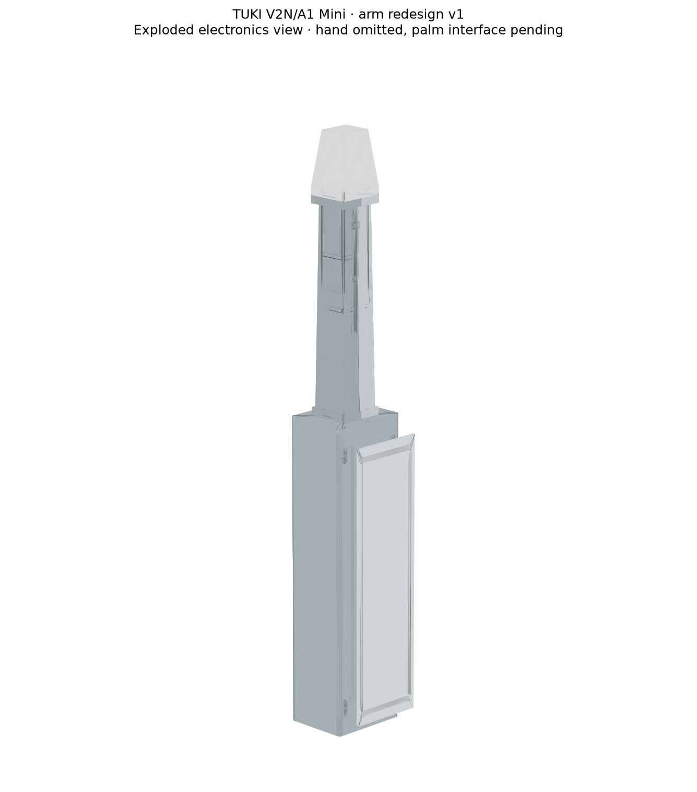

# TUKI V2N/A1 Mini — antebrazo y base v1

Iteración paramétrica preliminar creada sin modificar STL existentes de mano, CAMA_00/CAMA_01 ni V6. Sus seis piezas sustituyen en el gemelo web al antebrazo/caja anterior; no representan un ensamble físico validado. Unidades: mm. El generador editable es `build_tuki_v2n_arm_v1.py`; los parámetros están al inicio del archivo. Requiere CadQuery 2.8 o compatible.

## Vista y ensamblaje



- `generated/00_tuki_v2n_arm_v1_assembly.step`: ensamblaje CAD con envolventes de placa y regulador, para revisar en FreeCAD/Fusion.
- `generated/00_tuki_v2n_arm_v1_assembly.png`: vista explotada del panel. La mano no aparece porque las camas son coordenadas de impresión y no fijan su transformación de ensamblaje.
- Los STEP individuales de cada pieza se guardan en `generated/`; los parámetros, límites y orientaciones están documentados en este archivo y en el generador.

## Piezas nuevas

| Pieza | STL de impresión | Dimensiones máximas (mm) | Orientación generada |
|---|---|---:|---|
| Collar de muñeca estructural, canal 24 × 18 | `hardware/printables/forearm/v2n-arm-v1/01_wrist_collar_v1.stl` | 64 × 54 × 32 | Anillo apoyado en la brida inferior |
| Mitad izquierda del antebrazo hueco | `hardware/printables/forearm/v2n-arm-v1/02_forearm_left_v1.stl` | 110 × 54 × 32 | Cara de división sobre la cama |
| Mitad derecha del antebrazo hueco | `hardware/printables/forearm/v2n-arm-v1/03_forearm_right_v1.stl` | 110 × 54 × 32 | Cara de división sobre la cama |
| Caja electrónica inferior, sin batería | `hardware/printables/electronics-drawer/v2n-arm-v1/04_electronics_base_v1.stl` | 112 × 158 × 82 | Abertura de servicio hacia arriba |
| Tapa fija de servicio / panel USB-C configurable | `hardware/printables/electronics-drawer/v2n-arm-v1/05_electronics_service_cover_usb_panel_v1.stl` | 104 × 142 × 3 | Plana sobre la cama |
| Portaplaca universal con ranuras para bridas | `hardware/printables/electronics-drawer/v2n-arm-v1/06_electronics_carrier_v1.stl` | 68 × 142 × 2.8 | Plana sobre la cama |

Cada pieza tiene un STEP individual en `generated/`. El ensamblaje STEP incluye una envolvente FRDM-RW612 de 130 × 55 mm y un volumen provisional de regulador como referencias no imprimibles; el GLB auxiliar de las piezas no incluye esos volúmenes. El manual NXP especifica la placa de circuito de 130 × 55 mm. La profundidad total con componentes, el patrón de montaje y la ubicación/orientación del USB-C aún requieren medida directa.

## Interfaces, compatibilidad y límites

- La unión base–antebrazo y antebrazo–collar usa un patrón nuevo de cuatro tornillos M3 de holgura, definido internamente entre estas piezas nuevas.
- La cara superior del collar se deja sin agujeros. `palm_bolt_pattern_mm` y `palm_mating_datum_mm` permanecen sin definir: las camas `CAMA_00` y `CAMA_01` no son un datum de ensamblaje ni prueban la unión palma–muñeca. No se promete compatibilidad hasta medir la palma ya impresa.
- El conducto pasa por caja, antebrazo y collar; el antebrazo tiene tres nervaduras transversales con hueco central. Los SG90 permanecen en el rack de la mano.
- El panel es fijo durante el uso y desmontable con tornillos para servicio. El corte USB-C está desactivado (`usb_cutout_enabled=False`) hasta medir el puerto de la placa y el enchufe real. No imprimirlo como panel con puerto funcional sin configurar esas coordenadas.
- La envolvente FRDM-RW612 sólo garantiza que el PCB nominal 130 × 55 cabe en el espacio CAD configurado; no acredita altura de componentes, regulador, acceso a conectores, montaje ni cableado real. No se reserva volumen para batería.
- Los seis STL exportados son sólidos cerrados de un componente y cada uno cabe en 180 × 180 × 180 mm. No se han probado impresión, resistencia, vibración, tendones, compatibilidad con las piezas impresas ni holguras.
- El diseño se creó como nueva geometría paramétrica; no copia ni cambia los STL de mano suministrados. La procedencia/derechos de esos recursos históricos siguen documentados por separado en `docs/ASSET_LICENSES.md`.

## Regenerar

Desde la raíz del repositorio, con CadQuery 2.8 instalado:

```powershell
python hardware/cad/editable/tuki_v2n_arm_v1/build_tuki_v2n_arm_v1.py
python hardware/cad/editable/tuki_v2n_arm_v1/export_arm_glb.py
```

El primer comando genera las piezas paramétricas, STL preliminares, STEP y vistas del ensamblaje. El segundo exporta únicamente las seis piezas nuevas a `generated/tuki_v2n_arm_v1.glb`; no incluye la mano ni importa mallas anteriores. Para reconstruir el gemelo completo se necesita además una copia privada del GLB de mano anterior al reemplazo:

```powershell
cd web
node scripts/assemble-tuki-v2n-arm-v1.mjs `
  --hand-source ..\.local-private\tuki-v2n-before-arm-v1.glb `
  --arm-source ..\hardware\cad\editable\tuki_v2n_arm_v1\generated\tuki_v2n_arm_v1.glb `
  --output public\models\tuki-v2n.glb
```

El ensamblador quita el subárbol anterior `FOREARM` y `GUIA_CINCO_TENDONES` antes de exportar; conserva la mano, el rack diagonal, los proxies SG90, las poleas y los cinco clips. Los generadores de esta iteración no modifican las camas originales ni alteran los STL de mano ya impresos.
